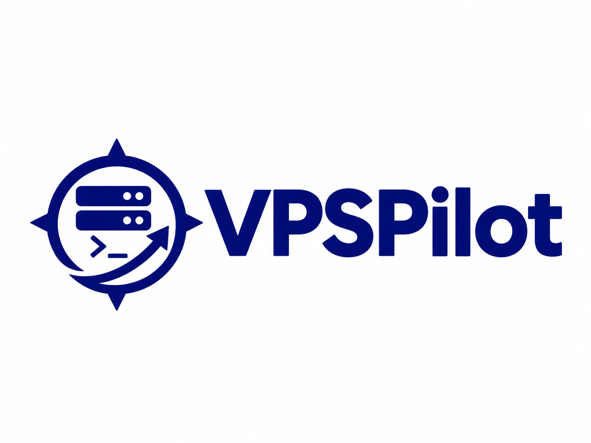

# VPSPilot 🚀

<div align="center">
  
  <p><strong>Orquestador de Despliegues, Respaldos y Monitoreo para Servidores VPS Ubuntu</strong></p>

  [](LICENSE)
  [](https://openjdk.org/)
  [](https://openjfx.io/)
  [](https://github.com/Dontoti02/vps-pilot/releases/latest)
  [](https://github.com/Dontoti02/vps-pilot/releases/latest)
</div>

---

## 📥 Descargas y Ejecución Rápida (.exe / Portable)

> [!TIP]
> **Zero Prerequisites:** No necesitas tener Java instalado en tu computadora. La versión portátil incluye un entorno de ejecución modular (JDK 25) optimizado e independiente.

| Opción | Archivo | Descripción | Enlace |
| :--- | :--- | :--- | :--- |
| **Recomendado (Portable Completo)** | `VPSPilot-1.1.0-portable.zip` | Paquete portátil completo (app + runtime + launcher .exe). Descomprimir y usar. | [⬇️ Descargar ZIP (v1.1.0)](https://github.com/Dontoti02/vps-pilot/releases/download/v1.1.0/VPSPilot-1.1.0-portable.zip) |
| **Ejecutable Directo** | `VPSPilot.exe` | Lanzador nativo de Windows (64-bit). | [⬇️ Descargar EXE](https://github.com/Dontoti02/vps-pilot/releases/download/v1.1.0/VPSPilot.exe) |
| **Todas las Versiones** | Historial de Releases | Registro de cambios, notas de versión y artefactos previos. | [📦 Ver Releases en GitHub](https://github.com/Dontoti02/vps-pilot/releases) |

### 🚀 Cómo Ejecutarlo en 3 Pasos:
1. **Descarga** el archivo `VPSPilot-1.1.0-portable.zip` desde la sección de [Releases](https://github.com/Dontoti02/vps-pilot/releases/latest).
2. **Descomprime** la carpeta en cualquier ubicación de tu PC (por ejemplo, en `C:\Program Files\VPSPilot`, en el Escritorio o en una memoria USB).
3. Haz doble clic en **`VPSPilot.exe`**.
   - Se abrirá la pantalla de seguridad de Windows.
   - Ingresa tu contraseña de usuario de la PC o presiona **"Usar PIN de Windows o Windows Hello"** para desbloquear la aplicación.

---

## ✨ Características Principales

### 🌐 Soporte Universal de Cualquier Repositorio Git
- **Compatibilidad total con cualquier proyecto Git:** Despliega cualquier repositorio de GitHub, GitLab o Git genérico (público o privado mediante personal access token).
- **Detección inteligente y adaptativa de Stack:**
  - **Laravel / Symfony / PHP:** Ejecuta `composer install`, optimizaciones de caché (`config:cache`, `route:cache`) y migraciones si detecta `artisan` o `composer.json`.
  - **Node.js / Frontend moderno (React, Vue, Vite):** Detecta `package.json` y ejecuta `npm install` + `npm run build` automáticamente.
  - **Sitios Web Estáticos o Frameworks con estructura custom:** Si no existe carpeta `public/`, enlaza automáticamente el directorio raíz o `dist/build` para que Nginx sirva la web sin configuraciones manuales.
- **Base de datos MySQL flexible:** Selecciona si tu repositorio requiere base de datos MySQL o no, y si deseas importar un esquema inicial personalizado o arrancar limpio.

### 🗄️ Gestión Integral de Bases de Datos Multimotor
- **Soporte completo para MySQL/MariaDB, PostgreSQL, SQLite y Redis:** Administra todas las bases de datos de tus proyectos desplegados desde una sola pantalla centralizada.
- **Diagnóstico de motores en tiempo real:** Comprueba el estado de los servicios relacionales (MySQL puerto 3306, PostgreSQL puerto 5432, SQLite y Redis puerto 6379), versiones y sockets del VPS.
- **Explorador de Tablas e Inspección:** Visualiza tablas, número de registros y espacio consumido en disco por cada base de datos.
- **Consola SQL Remota:** Ejecuta consultas directas (`SELECT`, `SHOW TABLES`, consultas complejas) a través de canales SSH protegidos con visualización tabular interactiva y atajos rápidos.
- **Mantenimiento y Volcados en 1 Clic:** Optimización y desfragmentación (`OPTIMIZE TABLE`, `VACUUM ANALYZE`), exportación e importación de volcados `.sql.gz` comprimidos al vuelo vía SFTP.
- **Creación y Eliminación Segura:** Crea nuevas bases de datos y usuarios dedicados con privilegios preconfigurados.

### 🚀 Despliegues Zero-Downtime
- Estrategia basada en symlinks atómicos (`current -> releases/YYYYMMDD_HHMMSS`).
- Clona o actualiza desde cualquier rama Git de forma segura.
- Gestión de permisos automáticos (`www-data`) y reinicio de servicios sin interrumpir conexiones activas.

### 🔄 Rollback Inmediato
- Si una migración de base de datos o un despliegue presenta problemas, puedes regresar al release funcional anterior con un solo clic.
- Registro completo de auditoría histórica de cada operación realizada.

### 💾 Respaldos Automatizados (SFTP)
- Respaldo previo obligatorio configurable antes de cada despliegue.
- Dump completo de bases de datos MySQL/MariaDB comprimido al vuelo (`.sql.gz`).
- Descarga y almacenamiento en tu disco local de Windows mediante SFTP seguro.

### 📊 Monitoreo en Vivo
- Diagnóstico en tiempo real del servidor VPS: uso de procesador (CPU), memoria RAM, uso de disco y tráfico de red.
- Comprobación del estado de servicios esenciales: Nginx, PHP-FPM, MySQL, Redis y Supervisor.
- Visor de logs en vivo de Laravel (`storage/logs/laravel.log`) y Nginx (`/var/log/nginx/error.log`).

### 🔐 Seguridad y Cifrado de Grado Empresarial
- **Cifrado DPAPI:** Las contraseñas y claves privadas SSH se cifran a nivel de hardware/usuario usando la API de Protección de Datos de Windows (`CryptProtectData`).
- **Verificación Estricta de Claves SSH:** Soporte completo de algoritmos modernos Ed25519, RSA y ECDSA con almacenamiento de `known_hosts`.
- **Autenticación Nativa de Windows:** Bloqueo biométrico o por contraseña al abrir el programa utilizando `Advapi32` y `CredUI`.

### 🎨 Diseño y Experiencia de Usuario
- Interfaz gráfica moderna construida con **JavaFX 25**.
- Soporte para **Tema Oscuro** y **Tema Claro**.
- **Onboarding animado** interactivo para nuevos usuarios (accesible en cualquier momento desde la barra lateral).

---

## 🖥️ Requisitos del Sistema

### Entorno de Usuario (PC de Gestión)
- **Sistema Operativo:** Windows 10 (versión 1809 o superior) o Windows 11 (64-bit).
- **Memoria RAM:** 512 MB de RAM libre.
- **Espacio en Disco:** ~250 MB para la versión portable con runtime embebido.

### Servidor de Destino (VPS)
- **Distribución:** Ubuntu 20.04 LTS, 22.04 LTS o 24.04 LTS.
- **Acceso:** SSH habilitado (puerto 22 u otro personalizado) con usuario `root` o usuario con privilegios `sudo`.
- **Pila:** Nginx, PHP (8.1, 8.2 o 8.3), MySQL/MariaDB, Composer y Git.

---

## 🛠️ Compilación desde el Código Fuente

Si deseas compilar **VPSPilot** por tu cuenta:

### Requisitos de Desarrollo
- **JDK 25** (o superior).
- **Apache Maven 3.9+**.
- **PowerShell 5.1+**.

### Pasos de Compilación
```powershell
# 1. Clonar el repositorio
git clone https://github.com/Dontoti02/vps-pilot.git
cd vps-pilot

# 2. Compilar y empaquetar con Maven
mvn clean package

# 3. Generar la imagen ejecutable portable con jpackage
powershell -ExecutionPolicy Bypass -File scripts/run_jpackage.ps1

# 4. Generar el archivo ZIP portable
python scripts/make_portable_zip.py
```
El ejecutable y el paquete distribuible se generarán en la carpeta `target/dist/VPSPilot/`.

---

## 📂 Estructura del Proyecto

```text
vps-pilot/
├── docs/                     # Documentación técnica, manual de usuario y auditoría
│   ├── auditoria-bolsalaboralv2.md
│   ├── manual-de-uso.md
│   ├── README-tecnico.md
│   └── PROMPT_MAESTRO.md
├── resources/                # Iconos, logotipos y assets de marca
│   ├── icono.ico
│   └── logo.png
├── scripts/                  # Scripts de automatización de compilación y empaquetado
│   ├── build.ps1
│   ├── MakeJar.java
│   ├── make_portable_zip.py
│   └── run_jpackage.ps1
├── src/                      # Código fuente de la aplicación
│   ├── main/
│   │   ├── java/com/bolsadeploy/  # Capas de dominio, aplicación, infraestructura y UI
│   │   └── resources/            # Estilos CSS (claro/oscuro), esquemas SQL y recursos
│   └── test/java/com/bolsadeploy/ # Pruebas unitarias y de integración
├── .gitignore                # Reglas de exclusión de Git
├── LICENSE                   # Licencia MIT
├── pom.xml                   # Configuración del proyecto Maven
└── README.md                 # Esta documentación
```

---

## 📄 Licencia

Este proyecto está bajo la Licencia **MIT** — consulta el archivo [LICENSE](LICENSE) para más detalles.

---

<div align="center">
  Desarrollado con ❤️ para simplificar la gestión y despliegue de servidores VPS.
</div>

